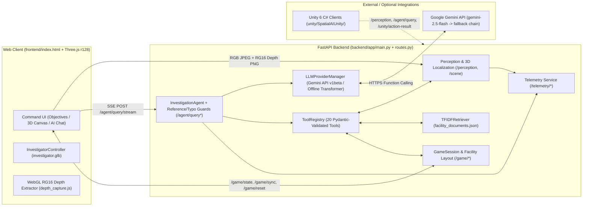

# Software Requirements Specification (SRS)
## Spatial Quest — Intelligent 3D Vision-Language Investigation Environment

| Field | Value |
| :--- | :--- |
| **Document ID** | `SQ-SRS-2026-001` |
| **Standard Basis** | ISO/IEC/IEEE 29148 / IEEE Std 830 |
| **Version** | `2.0.0` (Reflects Upgraded 3D Web UI, Measured WebGL Depth, Calibrated CNN & Hybrid Gemini/Offline LLM Pipeline) |
| **Date** | 2026-11-11 |
| **Repository Root** | `/Users/preranapradeep/Downloads/Spatial AI ` (`Spatial-Quest`) |
| **Academic Alignment** | CS4231 (Computer Vision), CS3235 (Language Models & Agentic AI), Computer Graphics / 3D Simulation |
| **Engineering Constraints** | [`AGENTS.md`](../AGENTS.md), [`PROJECT_SPEC.md`](../PROJECT_SPEC.md) |

---

## Table of Contents
1. [Introduction](#1-introduction)
2. [Overall Description](#2-overall-description)
3. [External Interface Requirements](#3-external-interface-requirements)
4. [System Functional Requirements](#4-system-functional-requirements)
5. [Non-Functional Requirements](#5-non-functional-requirements)
6. [Empirical Verification Baseline & Known Limitations](#6-empirical-verification-baseline--known-limitations)
7. [Requirements Traceability Matrix](#7-requirements-traceability-matrix)

---

## 1. Introduction

### 1.1 Purpose
This Software Requirements Specification (SRS) defines the functional, architectural, interface, data, safety, and quality requirements for **Spatial Quest** (also referenced internally as **SpatialAI**). It serves as the authoritative reference for engineering maintenance, academic viva defense, automated testing, and cross-machine deployment.

### 1.2 Scope
**Spatial Quest** is a full-stack, interactive 3D embodied vision-language investigation simulator set in a five-zone research facility (**Sector 4**). The system unifies four subsystems:
1. **Computer Vision & 3D Localization Subsystem**: A custom single-stage anchor-free CNN (`SpatialDetector`) built and trained from random initialization in PyTorch without pretrained backbones, paired with lossless WebGL RG16 millimeter depth extraction (`depth_capture.js`), pinhole back-projection, camera-to-world coordinate transforms, and directed 3D spatial scene graph synthesis.
2. **Language Model, Agentic Tool Engine & Local RAG Subsystem**: A hybrid dual-mode reasoning stack supporting the Google Gemini API (`google-genai` SDK with native multi-step function calling and model failover) alongside a custom-built from-scratch BPE tokenizer (`SpatialTokenizer`) and 4-layer causal Transformer (`DecoderTransformer`) offline fallback, augmented by a Pydantic-validated 20-tool registry and pure-Python/NumPy TF-IDF retrieval-augmented generation (RAG).
3. **Interactive 3D Client & Investigation Gameplay UI**: A responsive Three.js (`r128`) dark-blue Command UI hosting a rigged Mixamo humanoid investigator (`investigator.glb`), 5-zone architectural PBR facility (`facility3d.js`), 2D interactive blueprint map (`map_ui.js`), 6 structured mystery missions (`mission_a` through `mission_f`), SSE streaming AI chat, live CNN viewport overlay, and synchronized telemetry inspector.
4. **Unity 6 Academic Simulation Extension**: Companion C# scripts (`unity/SpatialAIUnity/Assets/Scripts/`) supporting synthetic RGB-D dataset capture and REST/action bridge compatibility.

### 1.3 Definitions, Acronyms, and Abbreviations
| Term | Definition |
| :--- | :--- |
| **CNN** | Convolutional Neural Network (`SpatialDetector`, from-scratch grid object detector) |
| **RG16 PNG** | Lossless 8-bit Red+Green PNG encoding 16-bit integer millimeter eye-space depth (`depth_encoding: "webgl_rg16_mm"`) |
| **BPE** | Byte-Pair Encoding subword tokenization (`SpatialTokenizer`) |
| **RAG** | Retrieval-Augmented Generation implemented via TF-IDF + cosine similarity (`TFIDFRetriever`) |
| **SSE** | Server-Sent Events streaming protocol used by `POST /agent/query/stream` |
| **MPS / CUDA** | Apple Silicon Metal Performance Shaders / NVIDIA GPU acceleration via PyTorch |
| **Sector 4** | Canonical 5-room metric investigation facility (`Reception`, `Research Office`, `Library`, `Laboratory`, `Storage Room`) |
| **Provenance** | Strict separation between `custom_detector` (live camera detections) and `facility_layout` (seeded 3D environment nodes) |

### 1.4 System Architecture Overview

---

## 2. Overall Description

### 2.1 Product Perspective
Spatial Quest operates as a self-contained local web application backed by a Python/FastAPI server and a zero-CDN local Three.js web frontend:
- **Relocatable Execution**: Launching [`run.py`](../run.py), [`scripts/run_server.py`](../scripts/run_server.py), or [`backend/app/main.py`](../backend/app/main.py) dynamically resolves and anchors `REPO_ROOT`, working directory, `PYTHONPATH`, `.env`, and `frontend/` static paths relative to the installation location, allowing the project to run identically from source or from an extracted portable ZIP archive.
- **No-Pretrained-Vision / Self-Contained Core Guarantee**: Per [`AGENTS.md`](../AGENTS.md), core object detection uses zero pretrained YOLO/ResNet/MobileNet weights, and offline text/RAG/geometry subsystems run strictly locally using checked-in model checkpoints (`models/`).

### 2.2 Product Functions Summary
1. Real-time 3D navigation across 5 interconnected architectural zones with rigged human avatar animations and collision resolution.
2. Live viewport RGB + RG16 linear depth capture, server-side from-scratch CNN inference, non-maximum suppression, pinhole 3D back-projection, and scene graph fusion.
3. Natural-language AI investigation assistant supporting SSE token/tool streaming, multi-turn conversation memory, typo normalization, anaphora resolution, RAG archival retrieval, and autonomous 3D avatar waypoint dispatching.
4. Case-based gameplay progression featuring 6 mysteries (`A`–`F`), interactive object inspection, security keypads/passcodes (`7391`), clue recovery, inventory tracking, score accounting, and timed containment challenges.
5. Multi-tab live telemetry inspection (`Overview`, `Computer Vision`, `3D Scene Graph`, `LLM & RAG`) correlated per query via unique `correlation_id` values.
6. Portable ZIP archive generation with asset integrity checks.

### 2.3 User Classes and Characteristics
| User Class | Description | Primary Workflows |
| :--- | :--- | :--- |
| **Investigator / Player** | Interacts via desktop, tablet, or mobile browser. | Explores 3D Sector 4, switches cameras (`1st`/`3rd`/`Top`), inspects objects (`E`), triggers live `CV Scan`, chats with AI Investigation Partner, completes Mysteries `A`–`F`. |
| **Academic Evaluator / Grader** | Evaluates CS4231/CS3235 compliance and scientific validity. | Inspects telemetry (`Overview`/`CV`/`3D Scene Graph`/`LLM & RAG`), toggles `gemini_api` vs `from_scratch` modes in Settings, audits `results/metrics/` and `pytest tests/`. |
| **Developer / Researcher** | Trains models, captures datasets, and packages distributions. | Runs dataset generators/downloaders (`scripts/`), trains CNN/Transformer checkpoints, evaluates split-clean metrics, builds portable archives via `scripts/package_project.py`. |

### 2.4 Operating Environment
* **Supported Operating Systems**: macOS (Darwin arm64/x86_64), Linux, or Windows with Python `3.9+` (`torch 2.15.0` verified on macOS arm64 MPS).
* **Hardware Compute**: Automatic device selection via `backend/perception/device.py` prioritizing Apple Silicon `mps`, then NVIDIA `cuda:0`, with automatic `cpu` fallback.
* **Client Browser**: Modern Chromium, Safari, or Firefox supporting HTML5 Canvas, WebGL / WebGL2, ES6+, Fetch Streaming (`ReadableStream`), and optional Web Speech API (`SpeechRecognition` / `speechSynthesis`).
* **Software Stack (`requirements.txt`)**: `torch>=2.0.0`, `numpy>=1.24.0`, `scipy>=1.10.0`, `scikit-learn>=1.2.0`, `pillow>=9.5.0`, `matplotlib>=3.7.0`, `fastapi>=0.100.0`, `uvicorn>=0.22.0`, `pydantic>=2.0.0`, `requests>=2.28.0`, `pyyaml>=6.0.0`, `python-dotenv>=1.0.0`, `google-genai>=1.0.0`, `pytest>=7.3.0`, `httpx>=0.24.0`.

### 2.5 Design and Implementation Constraints
1. **Strict Zero-Black-Box Core Perception & Offline LM (`AGENTS.md`)**: `SpatialDetector`, `SpatialTokenizer`, `DecoderTransformer`, and `TFIDFRetriever` must use inspectable from-scratch architecture and self-trained weights (`models/vision/spatial_detector_best.pt`, `models/language_model/transformer_best.pt`, `models/language_model/tokenizer.json`).
2. **Honest Metrics & Provenance (`AGENTS.md`)**: Pre-seeded room landmarks (`source: "facility_layout"`) must remain strictly separated from live neural detections (`source: "custom_detector"`), and offline fallback answers must never be mislabeled as Gemini API outputs.
3. **No Arbitrary Code Execution**: AI models may invoke tools exclusively by name and structured JSON arguments validated against Pydantic models in `TOOL_SCHEMA_MAP`.
4. **Secret Hygiene**: `.env` (containing `GEMINI_API_KEY`) must never be exposed in frontend JavaScript, committed to VCS, or included in generated distribution ZIPs (`scripts/package_project.py`).

### 2.6 Assumptions and Dependencies
* Internet access and a valid `GEMINI_API_KEY` are required only when running in `gemini_api` mode; if offline, quota-exhausted, or unconfigured, the system automatically degrades to `from_scratch` offline fallback without blocking UI or gameplay features.
* Pre-trained Unity Engine binaries are optional and not required to run the FastAPI + Three.js web simulation.

---

## 3. External Interface Requirements

### 3.1 User Interfaces (`frontend/index.html`, `frontend/assets/styles.css`)
The frontend renders a dark-blue command aesthetic (`background: rgb(9, 13, 20)` / `#090d14`) with zero external CDN dependencies:

1. **Top Navigation Bar (`#top-navbar`)**:
   - Brand emblem (`Spatial Quest — 3D Investigation Command`), active zone pill (`#nav-room-name`), investigator motion state pill (`#nav-investigator-state`: `Idle` / `Walking` / `Running`).
   - Camera segmented switcher (`#cam-mode-bar`): `3rd Person` (`2`), `1st Person` (`1`), `Top Down` (`3`).
   - Utility controls: **Map** (`#btn-map-modal`, shortcut `M`), **Telemetry** (`#btn-inspector-modal`), **Settings** (`#btn-settings-modal`), **Fullscreen** (`#btn-fullscreen`).
2. **Left Sidebar (`#left-sidebar`) — Investigation Objectives**:
   - Header with **Switch Case** button (`#btn-mission-modal`).
   - Active case card (`#mission-code-tag`, `#mission-score-tag`, `#mission-title`, `#mission-desc`, progress bar `#mission-progress-bar`, `#mission-progress-text`).
   - **Active Checklist** (`#objectives-list`) showing completion ticks updated only upon verified backend tool/game progress.
   - **Recovered Clues & Inventory** (`#inventory-list`) and footer actions (**Request Hint** `#btn-request-hint`, **Reset Case** `#btn-reset-case`).
3. **Center 3D Viewport (`#canvasContainer`)**:
   - `#three-canvas` with `preserveDrawingBuffer: true` for live RGB capture.
   - Minimal HUD telemetry pills: top-left coordinates & heading (`#hud-coords`, `#hud-heading`); top-right AI provider/model indicator (`#hud-llm-pill`, `#hud-llm-label`) and live CNN detection summary (`#hud-cv-pill`, `#hud-cv-label`).
   - Interactive overlays: 1st-person reticle (`#reticle`), live CNN bounding-box overlay (`#cv-bbox-overlay`), proximity interact prompt (`E`), clickable Selected Object Inspection Card (`#object-inspector-card` showing coordinates, distance, class, and `provenance`).
   - Bottom viewport dock (`#bottom-control-bar`): **CV Scan** (`#btn-cv-scan`), **Interact (E)** (`#btn-interact-nearest`), **Facility Map** (`#btn-toggle-map-bottom`).
4. **Right Sidebar (`#right-sidebar`) — AI Investigation Partner**:
   - Header with **Clear Chat** (`#btn-clear-chat`) triggering `POST /agent/clear`.
   - Companion focus tabs (`Scout (Vision)`, `Navigator (3D)`, `Archivist (RAG)`).
   - Scrollable transcript (`#chat-messages`) rendering tool pills (`tool: <name>`), fallback pills (`fallback: offline transformer`), model name + latency metadata, and unbroken numeric/coordinate spans.
   - Suggestion chips (`Survey room`, `Locate table`, `Go to Lab`, `Door 3 code`, `Objectives`), microphone button (`#micBtn`), TTS speaker toggle (`#ttsToggleBtn`), text input (`#chatInput`), and **Send** (`#sendBtn`).
5. **Interactive Modals**:
   - **Facility Blueprint Map (`#map-modal`)**: Top-down Sector 4 schematic (`map_ui.js`) showing investigator heading, scene graph nodes, selected target, autopilot path, and Door 3 lock status (`#f43f5e` locked vs `#10b981` unlocked); clicking anywhere dispatches autopilot navigation.
   - **Live System Telemetry & Provenance Inspector (`#inspector-modal`)**: 4 tabs (`Overview`, `Computer Vision`, `3D Scene Graph`, `LLM & RAG`) displaying live `/telemetry/latest` and `/scene` JSON traces.
   - **Select Investigation Case (`#mission-modal`)**: Grid selector for Cases `A`–`F`.
   - **Simulation & AI Settings (`#settings-modal`)**: Live provider switcher (`Google Gemini API` vs `Offline Fallback`), look sensitivity slider (`0.4`–`2.5`), dynamic shadow toggle, and control reference.
6. **Responsive Mobile & Tablet Layout (`styles.css`)**:
   - CSS media breakpoints at `max-width: 1120px`, `max-width: 960px`, `max-width: 600px`, and landscape `max-height: 460px and max-width: 960px`.
   - Below `960px`, displays `#mobile-tab-bar` (`3D Scene` | `AI Assistant` | `Objectives`) and touch controls (`#mobile-controls` virtual D-pad + `Interact`, `CV Scan`, `Turn 180°`).

### 3.2 Hardware & Browser Capabilities
* **Server Acceleration**: Uses `torch.device("mps")` on Apple Silicon when `mps.is_available() and mps.is_built()`, else `cuda:0`, else `cpu`.
* **Client WebGL**: Requires WebGL context capable of `RGBAFormat` / `UnsignedByteType` `WebGLRenderTarget` offscreen depth passes (`depth_capture.js`) and skinned GLTF mesh rendering (`GLTFLoader.js`).

### 3.3 Software Interfaces (REST & SSE Endpoints — [`backend/api/routes.py`](../backend/api/routes.py))

All HTML/JS/CSS routes (`/`, `/index.html`, `/three.min.js`, `/assets/*`) respond with `Cache-Control: no-store, no-cache, must-revalidate, max-age=0`, `Pragma: no-cache`, and `Expires: 0`.

| Method & Path | Request Schema | Response Schema | Purpose |
| :--- | :--- | :--- | :--- |
| `GET /health` | — | `HealthResponse` | System health, PyTorch device info, model load flags, scene node count, uptime |
| `POST /perception` | `PerceptionRequest` | `PerceptionResponse` | Decodes base64 RGB + optional RG16 depth PNG, runs `SpatialDetector` + NMS + 3D localization, merges `custom_detector` detections into `global_scene_graph` |
| `GET /scene` | — | `SceneGraphResponse` | Returns all current 3D nodes (with provenance/depth source) and directional spatial edges |
| `POST /agent/query` | `AgentQueryRequest` | `AgentQueryResponse` | Runs synchronous multi-step reasoning, executes validated tools, returns reply, `unity_action`, `game_state`, and model metadata |
| `POST /agent/query/stream` | `AgentQueryRequest` | `text/event-stream` | Streams SSE frames: `event: tool_call`, `event: delta`, and `event: done` (full `AgentQueryResponse`) |
| `POST /agent/clear` | `{"session_id": str}` | JSON status | Clears server conversation history for `session_id` and resets agent turn memory |
| `GET /llm/status` | — | JSON status | Reports `active_mode`, `configured_mode`, `is_api_available`, `model_name`, `effective_model_name`, `last_model_used`, `last_used_fallback`, `has_api_key`, `last_error` |
| `POST /llm/mode` | `{"mode": str}` | JSON status | Switches runtime provider between `gemini_api` and `from_scratch` (rejects `gemini_api` cleanly if key absent) |
| `GET /telemetry/latest` | — | JSON trace | Returns most recent correlated CV / CG / LLM telemetry snapshot |
| `GET /telemetry/{correlation_id}` | Path `correlation_id` | JSON trace | Retrieves historical telemetry record matching `correlation_id` |
| `GET /game/state` | — | JSON game state | Returns active mission, catalog `missions`, objectives, inventory, score, timer remaining, and environment state (`door_3`) |
| `POST /game/start` | `GameStartRequest` | JSON game state | Starts mission (`mission_id`) |
| `POST /game/select-mystery` | `GameStartRequest` | JSON game state | Switches active investigation case (`mission_a`–`mission_f`) |
| `POST /game/reset` | `GameResetRequest` | JSON game state | Resets session state with optional RNG `seed` (default `42`), locks `door_3`, clears live CV overlay nodes and re-seeds layout |
| `POST /game/restart` | — | JSON game state | Restarts active mission cleanly |
| `POST /game/hub` | — | JSON game state | Returns investigator state to Reception / Central Hub |
| `POST /game/agent` | `GameAgentRequest` | JSON game state | Selects specialist companion focus (`scout`, `navigator`, `archivist`) |
| `POST /game/sync` | `PlayerSyncRequest` | JSON sync status | Updates investigator `[X, Z]` / `[X, Y, Z]` position and `active_room` in backend session state |
| `POST /unity/action-result` | `UnityActionResult` | JSON ack | Records navigation/action execution confirmation from external Unity client |
| `GET /cv/benchmark_sample` | Query `index: int = 0` | JSON sample | Serves held-out benchmark sample metadata/inspection payload |

---

## 4. System Functional Requirements

### 4.1 Computer Vision & Perception (`FR-CV`)
* **FR-CV-001 (Custom CNN Detector)**: The system shall perform object detection using `SpatialDetector` (`backend/perception/model.py`), a 5-stage stride-2 convolutional backbone (`[32, 64, 128, 256, 256]`) with a 16x-to-32x `skip4` multi-scale fusion neck and `1x1` grid prediction head (`2,556,715` parameters, Kaiming random initialization), mapping `(B, 3, 480, 640)` RGB tensors to `(B, 15, 20, 11)`.
* **FR-CV-002 (Canonical Vocabulary)**: Perception shall classify predictions into 6 indoor classes matching `configs/vision.yaml`: `table` (0), `chair` (1), `door` (2), `bookshelf` (3), `sofa` (4), and `cabinet` (5).
* **FR-CV-003 (Training Loss Formulation)**: Detector training (`backend/perception/losses.py`) shall optimize combined Focal + Online Hard Example Mining (OHEM) objectness loss, GIoU + Smooth L1 bounding-box regression loss, and label-smoothed Cross-Entropy (`0.05`) classification loss.
* **FR-CV-004 (Decoding, Dual NMS & Calibration)**: Post-processing (`backend/perception/metrics.py`) shall apply validation-calibrated per-class confidence thresholds (`table: 0.58`, `chair: 0.42`, `door: 0.50`, `bookshelf: 0.62`, `sofa: 0.58`, `cabinet: 0.42` for the current checkpoint), class-aware NMS (`IoU >= 0.45`), and cross-class suppression (`IoU >= 0.55`).
* **FR-CV-005 (Strict Dataset Split Hygiene)**: SUN RGB-D (`280` real scenes: `train=168, val=42, test=70`) and Three.js Sector 4 (`254` frames: `train=175, val=37, test=42`) benchmarks shall maintain zero sequence-group, image-MD5, and `(x, z)` viewpoint leakage across `train`, `val`, and `test`.
* **FR-CV-006 (Strict Provenance Separation)**: Calling `POST /perception` (`mock_mode=false`) shall execute live `SpatialDetector` inference and merge results into `global_scene_graph` with `object_id` prefixed `cnn_` and `source="custom_detector"`, preserving pre-seeded `facility_layout` landmarks separately without overwriting or mislabeling provenance.

### 4.2 Measured Depth & 3D Spatial Localization (`FR-3D`)
* **FR-3D-001 (WebGL Millimeter Depth Capture)**: When executing a browser `CV Scan`, `frontend/assets/depth_capture.js` shall render an offscreen synchronized eye-space linear Z (`-mvPosition.z`) shader pass (`skinning: true` for rigged avatars) into a `NearestFilter` `WebGLRenderTarget` and encode millimeter depth into lossless RG16 PNG (`R = floor(mm/256)`, `G = mm % 256`, `A = 255`) with `depth_encoding="webgl_rg16_mm"`.
* **FR-3D-002 (Robust Depth Sampling)**: `backend/spatial/geometry.py` (`sample_robust_depth_from_box`) shall sample median metric depth inside the central box region, filter foreground clusters (`valid <= np.percentile(valid, 20) + 1.1m` when `reject_background=True`) to avoid background wall bleed-through, and explicitly record `depth_source="measured_webgl_depth"` (or `"measured_rgbd_sensor"`) versus `"estimated_bbox_height"` fallback when depth pixels are unavailable.
* **FR-3D-003 (Pinhole Back-Projection & Coordinate Transforms)**: `backend/spatial/localization.py` shall compute camera-frame 3D coordinates using calibrated intrinsics $(f_x, f_y, c_x, c_y)$ and apply camera pose quaternion transformation into world coordinates supporting both `coordinate_system="threejs"` (`-Z` optical axis forward) and `coordinate_system="unity"` (`+Z` forward).
* **FR-3D-004 (Directed 3D Spatial Scene Graph)**: `backend/spatial/scene_graph.py` shall maintain nodes and recompute geometric spatial edges (`left_of`, `right_of`, `in_front_of`, `behind`, `above`, `on`, `near`) with pairwise Euclidean distances (`distance_meters`) and synonym resolution (`desk`↔`table`, `couch`↔`sofa`, `bookcase`↔`bookshelf`, `exit`↔`door`).

### 4.3 Interactive 3D Environment & Rigged Character (`FR-CG`)
* **FR-CG-001 (5-Zone Facility Geometry)**: The 3D facility (`backend/game/facility.py`, `frontend/assets/facility3d.js`) shall model 5 contiguous metric zones populated with `19` synchronized architectural objects:
  1. **Reception / Central Hub** ($Z \in [-24, -10]$, $X \in [-12, 12]$)
  2. **Research Office** ($Z \in [-10, 0]$, $X \in [0, 12]$)
  3. **Library / Archives** ($Z \in [-10, 0]$, $X \in [-12, 0]$)
  4. **Investigation Laboratory** ($Z \in [0, 10]$, $X \in [-12, 12]$)
  5. **Storage Room** ($Z \in [10, 24]$, $X \in [-12, 12]$)
* **FR-CG-002 (Rigged Human Investigator)**: `frontend/assets/investigator3d.js` shall load the Mixamo rigged GLB humanoid (`./assets/investigator.glb`, root `InvestigatorRoot`) with smooth animation crossfading (`Idle`, `Walk`, `Run`, plus interact pulse) and provide an articulated humanoid fallback if `file://` CORS restricts GLB loading.
* **FR-CG-003 (Camera & Locomotion Controls)**: The controller shall support WASD/Arrow walking (`4.6 m/s`), `Shift` running (`7.8 m/s`), mobile virtual D-pad locomotion, drag-to-orbit look + wheel pitch, AABB collider sliding, doorway passage through `door_3` once unlocked, and `1st`/`3rd`/`Top` camera modes (`1`/`2`/`3` keys).
* **FR-CG-004 (Autopilot Navigation)**: When `navigate_to` returns `unity_action.waypoints` (or a user clicks on the 2D `FacilityMapRenderer` canvas), `state.autopilotQueue` shall steer the human investigator along obstacle-avoiding room-to-room waypoints (`compute_turn_by_turn_route`).
* **FR-CG-005 (Unity 6 Integration)**: `unity/SpatialAIUnity/Assets/Scripts/` shall preserve compatible C# scripts (`LabSceneGenerator.cs`, `RuntimePerceptionSender.cs`, `SyntheticDataCapture.cs`, `ChatUIController.cs`, `MissionManager.cs`, `UnityActionReceiver.cs`) communicating via `/perception`, `/agent/query`, and `/unity/action-result`.

### 4.4 Language Models, Reasoning & RAG (`FR-LLM`)
* **FR-LLM-001 (Primary Gemini API Reasoning & Streaming)**: When `SPATIAL_LLM_MODE` resolves to `gemini_api` and a valid `GEMINI_API_KEY` is configured server-side, `GeminiAPIClient` (`backend/language_model/llm_provider.py`, `v1beta`) shall pass `SPATIAL_QUEST_SYSTEM_INSTRUCTION`, live Facility Context Snapshot (current room, coordinates, active case objectives, inventory, separated `live_cnn_perception` vs `facility_layout` objects, scene graph edges, and pre-retrieved RAG passages), conversation memory (`SessionMemoryManager`, max `10` turns), and auto-converted `TOOL_SCHEMA_MAP` declarations to Gemini.
* **FR-LLM-002 (Automatic Model Failover & Quota Cooldown)**: Upon `model_not_found`, `quota_exceeded`, `service_unavailable`, or `timeout`, `GeminiAPIClient` shall record an exhaustion cooldown (`90s` transient / `3600s` missing model) and fail over across `GEMINI_MODEL` → `gemini-2.5-flash-lite` → `gemini-flash-lite-latest` → `gemini-3-flash-preview` without stalling requests beyond bounded HTTP timeouts (`GEMINI_TIMEOUT_SECONDS`, default `15.0s`).
* **FR-LLM-003 (From-Scratch Offline Transformer Fallback)**: When `GEMINI_API_KEY` is absent, `mode=from_scratch`, or all Gemini API attempts fail cleanly, `InvestigationAgent` shall execute using the locally loaded `SpatialTokenizer` (`55K`) and 4-layer `DecoderTransformer` (`d_model=128`, `n_heads=4`, `d_ff=512`, `max_seq_len=256`, `4.4M` checkpoint) paired with deterministic schema-validated intent/tool execution and honest fallback signaling (`used_fallback=true`, amber UI badge).
* **FR-LLM-004 (Multi-Turn Reference & Typo Resolution)**: Before routing or generation, queries shall pass through `typo_normalizer.py` (Levenshtein distance with controlled vocabulary protection so `len <= 3` only maps explicit abbreviations and unknown domain nouns remain uncorrupted) and `ReferenceResolver` (resolving anaphora such as `"it"`, `"there"`, `"that object"`, `"from here"` cleanly across object/room state transitions).
* **FR-LLM-005 (TF-IDF Local RAG)**: `TFIDFRetriever` (`backend/rag/retriever.py`) shall chunk and index `data/documents/facility_documents.json` (`DOC-001`–`DOC-006`) using stopword-filtered TF-IDF cosine similarity (`top_k=3`, pre-retrieval `min_score=0.20`), enabling grounded retrieval of Facility Incident Report 104-A, Safety Protocol 22, Door 3 override code (`7391` for seed 42), and Artifact Omega records.
* **FR-LLM-006 (Output Number & Coordinate Integrity)**: `normalize_response_formatting` shall repair mid-token newline splits inside security codes (`7391`), numeric metrics, and `[X, Y, Z]` coordinate tuples without mutating numeric values.

### 4.5 Tool Registry & Agentic Execution (`FR-TOOL`)
* **FR-TOOL-001 (Pydantic Whitelist Dispatch)**: `ToolRegistry` (`backend/tools/registry.py`) and `TOOL_SCHEMA_MAP` (`backend/tools/schemas.py`) shall enforce whitelist validation across exactly **20 registered tools**:
  - *Spatial & Perception (10)*: `get_visible_objects` (supports `live_only=True` filter), `locate_object`, `query_spatial_relation`, `calculate_distance`, `find_nearest_target`, `find_nearest_exit`, `find_path`, `navigate_to`, `inspect_object_closely`, `get_current_location`
  - *Investigation & Mission State (6)*: `inspect_clue`, `interact_with_object` (supports `object_id` & optional 4-digit `passcode`), `get_inventory`, `get_mission_objectives`, `request_hint`, `get_game_guide`
  - *Knowledge & Grounded Guardrails (4)*: `search_documents`, `search_safety_manual`, `explain_uncertainty`, `explain_unreachable`
* **FR-TOOL-002 (Bounded Multi-Step Execution)**: Agent reasoning turns shall enforce `max_steps=4` (`max_iterations_per_turn`) per user query and forbid execution if tool validation fails.
* **FR-TOOL-003 (Specialist Focus Modes)**: The UI persona selector (`scout`, `navigator`, `archivist`) shall update `agent_id` focus metadata in backend game state while preserving access to the full tool schema map.

### 4.6 Investigation Gameplay & Mission Engine (`FR-GAME`)
* **FR-GAME-001 (Six Investigation Cases)**: `backend/game/missions.py` shall provide 6 selectable cases:
  - `mission_a`: *Mystery A: Missing Research Key* (`research_key` retrieval + table localization)
  - `mission_b`: *Mystery B: Missing Research File* (spatial relation left of table + distance calculation)
  - `mission_c`: *Mystery C: Laboratory Containment* (nearest door/exit + waypoint route planning)
  - `mission_d`: *Clue Room & RAG* (`clue_pda_02` inspection + RAG override search + Door 3 unlock)
  - `mission_e`: *Timed Containment* (`180s` countdown timer to survey lab, retrieve override via RAG, unlock Door 3)
  - `mission_f`: *Dataset Terminal* (SUN RGB-D terminal verification & multi-class facility survey)
* **FR-GAME-002 (Verified Objective Progression & Seeded Variation)**: Mission objectives shall advance exclusively when verified tool execution (`record_tools`) satisfies required tool names, targets, or collected inventory items (`research_key`, etc.). `POST /game/reset` with variable `seed` deterministically varies key/archive placements and randomized override codes (`seed=42` retains canonical code `7391`).
* **FR-GAME-003 (Interactive Door 3 Lock)**: `interact_with_object` with `object_id="door_3"` and matching `passcode` (`7391` on seed `42`) unlocks `environment_state["door_3"] = "unlocked"`, updating 3D barrier colliders and map indicators immediately.

### 4.7 Telemetry, Startup Anchoring & Portable Packaging (`FR-SYS`)
* **FR-SYS-001 (Turn Correlation Telemetry)**: Every `/perception` and `/agent/query*` turn shall log a `correlation_id`-tagged snapshot in `backend/api/telemetry.py` containing CV detections/benchmarks, CG pose/room, and LLM provider/latency/tool/RAG metrics.
* **FR-SYS-002 (Port-Safe Launcher)**: `run.py` shall check `is_port_in_use(port)` before booting or opening a web browser so stale port-8000 processes never silently intercept the launched frontend URL.
* **FR-SYS-003 (Relocatable Packaging Verification)**: `scripts/package_project.py` shall produce a self-contained ZIP (`Spatial-Quest/`) passing automated presence checks for core entrypoints, checkpoints, all 9 `frontend/` assets, and updated UI DOM markers.

---

## 5. Non-Functional Requirements

| ID | Category | Requirement | Verification Target / Method |
| :--- | :--- | :--- | :--- |
| **NFR-001** | **Performance** | `GET /health` latency on local server | `< 50 ms` |
| **NFR-002** | **Performance** | Real-time Three.js WebGL scene rendering | Smooth interactive frame loop; live HUD & shadow toggle supported on low-power devices |
| **NFR-003** | **Performance** | Single-frame `SpatialDetector` inference latency (CPU/MPS) | `< 100 ms` pure PyTorch forward pass (`43.06 ms` measured in evaluation script); `< 1.0 s` round-trip including browser canvas + RG16 PNG encode (`394–819 ms` measured via SwiftShader E2E) |
| **NFR-004** | **Performance** | Checkpoint disk footprint | Total core model checkpoints `< 35 MB` (`spatial_detector_best.pt` `29 MB` + `transformer_best.pt` `4.4 MB` + `tokenizer.json` `55 KB`) |
| **NFR-005** | **Safety & Security** | Zero arbitrary code execution; zero secret leakage | Pydantic schema gate (`TOOL_SCHEMA_MAP`); `.env` excluded from client JS, Git, and ZIP |
| **NFR-006** | **Reliability** | Fault-tolerant LLM failover & offline survival | Automatic Gemini fallback chain + instant degradation to `from_scratch` offline transformer on missing key / quota / timeout |
| **NFR-007** | **Consistency** | Fresh UI delivery across restarts & directory moves | HTTP `Cache-Control: no-store` on all HTML/CSS/JS/GLB frontend assets + UI marker unit & CDP tests |
| **NFR-008** | **Usability & Responsiveness** | Consistent layout on desktop, tablet, and mobile viewports | Verified across `1440px` desktop plus `1120px`, `960px`, `600px`, and mobile landscape CSS breakpoints |

---

## 6. Empirical Verification Baseline & Known Limitations

Per `AGENTS.md`, all numbers below reflect real measurements recorded on held-out evaluation splits and live browser/pytest runs (no fabricated metrics):

1. **Automated Test Suite**: `pytest tests/ -q` (`140 passed` in workspace; `17 passed` standalone API/UI checks inside extracted ZIP).
2. **Computer Vision (`SpatialDetector`, Epoch 34 Checkpoint)**:
   - **Held-Out Three.js Sector 4 (`42` test frames)**: `mAP@0.5 = 0.2868`, `overall_precision = 0.2038` (up from `0.109` prior baseline), `overall_recall = 0.4943`, `overall_f1 = 0.2886` (`TP=43, FP=168, FN=44`; per-class AP: `cabinet: 0.5955`, `chair: 0.402`, `bookshelf: 0.3636`, `table: 0.3594`, `door: 0.0`, `sofa: 0.0`).
   - **Held-Out SUN RGB-D (`70` test frames, `402` GT objects)**: `mAP@0.5 = 0.0251`, `overall_precision = 0.0476`, `overall_recall = 0.0945` (`TP=38, FP=760, FN=364`; `door: 0.0909`, `table: 0.0455`, `chair: 0.0145`).
   - **3D Localization Error (Three.js `test`)**: `measured_webgl_depth` achieved **`0.410 m` median** (`0.871 m` mean) on oracle 2D boxes and **`0.370 m` median** (`0.615 m` mean) on live CNN detections vs. `1.584 m` median (`1.927 m` mean) with the bounding-box height heuristic. Real SUN RGB-D sensor depth error measured `0.439 m` mean / `0.330 m` median.
3. **Offline Fallback Agent (`results/metrics/agent_comprehensive_evaluation.json`, 250 samples)**: Tool selection accuracy `62.4%`, spatial reasoning accuracy `89.47%`, conversational context retention `100.0%`, hallucination rate `0.0%`, end-to-end task success `88.0%`.
4. **Known System Limitations**:
   - Dense/occluded Three.js viewpoints still generate excess `chair` false positives (`FP=168`), while sparse `door` and `sofa` test angles yield `0.0` AP on the 42-frame Sector 4 test set.
   - Real-world cross-domain generalization on cluttered SUN RGB-D scenes remains limited (`mAP@0.5 = 0.0251`) due to the constrained `2.56M`-parameter from-scratch single-stage grid architecture trained on `168` real scenes.
   - Gemini API primary model requests (`gemini-2.5-flash`) may encounter free-tier quota limits, seamlessly failing over to lighter configured Gemini variants or `from_scratch` offline fallback.

---

## 7. Requirements Traceability Matrix

| Requirement Group | Primary Implementation Modules | Automated Verification Tests |
| :--- | :--- | :--- |
| **FR-CV-001 .. FR-CV-006** | `backend/perception/{model.py, losses.py, metrics.py, sun_rgbd_loader.py}`, `configs/vision.yaml` | `tests/test_vision_model.py`, `tests/test_sunrgbd_loader.py`, `tests/test_priorities_regression.py` |
| **FR-3D-001 .. FR-3D-004** | `frontend/assets/depth_capture.js`, `backend/spatial/{geometry.py, localization.py, scene_graph.py}` | `tests/test_geometry.py`, `tests/test_localization.py`, `tests/test_scene_graph.py` |
| **FR-CG-001 .. FR-CG-005** | `frontend/index.html`, `frontend/assets/{facility3d.js, investigator3d.js, map_ui.js, styles.css}`, `backend/game/facility.py`, `unity/` | `tests/test_api.py`, Headless Chrome CDP E2E (`verify_original_ui.png` / `verify_extracted_ui.png`) |
| **FR-LLM-001 .. FR-LLM-006** | `backend/language_model/{llm_provider.py, transformer.py, tokenizer.py}`, `backend/agent/{investigation_agent.py, prompt_builder.py, reference_resolver.py, typo_normalizer.py}`, `backend/rag/retriever.py`, `data/documents/facility_documents.json` | `tests/test_tokenizer.py`, `tests/test_transformer.py`, `tests/test_rag.py`, `tests/test_agent.py`, `tests/test_priorities_regression.py` |
| **FR-TOOL-001 .. FR-TOOL-003** | `backend/tools/{schemas.py, registry.py}`, `configs/agent.yaml` | `tests/test_agent.py`, `tests/test_api.py` |
| **FR-GAME-001 .. FR-GAME-003** | `backend/game/missions.py`, `backend/api/routes.py` | `tests/test_missions.py`, `tests/test_api.py` |
| **FR-SYS-001 .. FR-SYS-003** | `backend/api/telemetry.py`, `backend/app/main.py`, `run.py`, `scripts/run_server.py`, `scripts/package_project.py` | `tests/test_api.py::test_expected_ui_consistency_and_no_cache_headers`, portable ZIP extract E2E |

