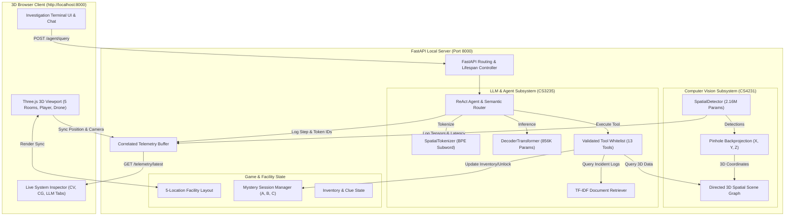

# SDLC Stage 3: System Design

**Project Name**: Spatial Quest (SpatialAI)  
**Document Version**: 1.0.0  
**Status**: Approved  

---

## 1. System Architecture Overview

Spatial Quest is built around a tripartite architectural separation separating the three primary computer science disciplines:
1. **Computer Vision (Perception Subsystem)**: Determines *what is visually present and where it is located* through CNN feature extraction, grid predictions, depth estimation, and 3D backprojection.
2. **Computer Graphics (Simulation Subsystem)**: Determines *how the 3D world is rendered, structured, and interacted with* through Three.js WebGL scenes, cameras, lighting, collision boundaries, and avatar/drone meshes.
3. **Language Model & Agents (Reasoning Subsystem)**: Determines *what the player means, which information is required, which tool to call, and which game action to execute* through custom subword tokenization, decoder Transformer inference, tool dispatch, and local RAG.



---

## 2. Component Responsibilities

### 2.1 Computer Vision Subsystem (`backend/perception/` & `backend/spatial/`)
- **`SpatialDetector` (`model.py`)**: 5-stage CNN backbone processing $(480, 640, 3)$ RGB frames into $(15, 20, 11)$ output grids containing objectness, bounding box offsets $(t_x, t_y, t_w, t_h)$, and class logits.
- **`losses.py`**: Multi-task loss combining Binary Cross-Entropy (objectness), Smooth L1 (bbox), and Cross-Entropy (classes).
- **`geometry.py` & `localization.py`**: Mathematical camera backprojection using calibrated pinhole intrinsics ($f_x = 525, f_y = 525, c_x = 320, c_y = 240$) and sensor tilt rotation matrices:
  $$X_c = \frac{(u - c_x) Z_c}{f_x}, \quad Y_c = \frac{(v - c_y) Z_c}{f_y}$$
  $$P_w = R_{\text{tilt}}^T P_c + T_{\text{sensor}}$$
- **`scene_graph.py`**: Manages detected objects, evaluates spatial predicates (`left_of`, `right_of`, `above`, `near`), and calculates exact Euclidean distances in meters.

### 2.2 LLM & Agent Subsystem (`backend/language_model/`, `backend/agent/`, `backend/rag/`, `backend/tools/`)
- **`SpatialTokenizer` (`tokenizer.py`)**: Custom subword tokenizer with 384 learned BPE tokens and specialized control tokens.
- **`DecoderTransformer` (`transformer.py`)**: 4-layer decoder-only Transformer with multi-head attention ($n_h = 4, d_m = 128$), lower-triangular causal attention masking, Pre-LayerNorm, and GeLU feed-forward networks.
- **`InvestigationAgent` (`investigation_agent.py`)**: Multi-step ReAct loop with prompt formatting, structured JSON output extraction, deterministic semantic routing fallback, observation feedback, and natural-language synthesis.
- **`ToolRegistry` (`tools/registry.py`)**: Whitelist of 13 validated tools enforcing argument validation and safety checks.
- **`TFIDFRetriever` (`rag/retriever.py`)**: Text chunker, TF-IDF vectorizer, and cosine-similarity search over `data/documents/facility_documents.json`.

### 2.3 Computer Graphics & Gameplay Subsystem (`frontend/` & `backend/game/`)
- **`frontend/index.html` (Three.js)**: 
  - Scene renderer with realistic lighting (ambient, directional sunlight, and per-room colored spotlights).
  - Procedural generation of all **5 facility locations**: Reception, Research Office, Library/Archives, Investigation Lab, Storage Room.
  - Interactive avatar with flashlight, visor glow, bounding volumes, and third/first/top-down camera rigs.
  - Companion drone with pulsing ring thrusters, laser scanner cone, and smooth escort/waypoint interpolation.
  - **Live System Inspector**: Sliding 3-tab panel exposing telemetry from CV, CG, and LLM.
- **`backend/game/facility.py`**: Single source of truth for static 3D metric coordinates of all furniture and architectural elements across all 5 rooms.
- **`backend/game/missions.py`**: Manages state machines for Mysteries A, B, and C, seed-based randomization, player inventory, clue collection, objective progression, and score tracking.

---

## 3. Data-Flow Diagrams

### 3.1 Perception to Scene Graph Data Flow
```
[RGB Camera Frame (480x640) + Depth Map (480x640)]
                      │
                      ▼
            [SpatialDetector CNN]
                      │
        Grid Outputs: Obj, BBox, Logits
                      │
                      ▼
       [Non-Maximum Suppression (NMS)]
                      │
        Filtered 2D BBoxes (xmin, ymin, xmax, ymax)
                      │
                      ▼
       [Pinhole Backprojection (geometry.py)]
                      │
        Camera Coordinates (Xc, Yc, Zc)
                      │
                      ▼
       [Tilt Matrix Transformation (localization.py)]
                      │
        Metric World Centroids (Xw, Yw, Zw)
                      │
                      ▼
       [SceneGraphManager (scene_graph.py)]
                      │
  Nodes (Objects) + Edges (Spatial Predicates)
```

### 3.2 Natural-Language Query to Action Data Flow
```
[Player Natural-Language Query]
               │
               ▼
     [POST /agent/query]
               │
               ▼
    [SpatialTokenizer: Text -> Token IDs]
               │
               ▼
    [DecoderTransformer Forward Pass]
               │
               ▼
    [Tool Call Extraction: <tool_call>{"name": ..., "arguments": ...}</tool_call>]
               │
               ▼
    [ToolRegistry Execution Guardrails]
               │
     ┌─────────┴─────────┐
     ▼                   ▼
[Perception/Scene]    [RAG Search]
 (Distance, Path,     (Facility Docs,
  Object Search)       Override Code)
     └─────────┬─────────┘
               │
               ▼
    [Tool Observation JSON]
               │
               ▼
    [Natural Language Synthesizer]
               │
               ▼
[Response to Frontend + 3D Viewport Action + Telemetry Record]
```

---

## 4. Integration Contracts

1. **Client $\leftrightarrow$ Backend REST API**:
   - `POST /agent/query`: Accepts `AgentQueryRequest` (`query`, `agent_id`, `mission_id`), returns `AgentQueryResponse` (`tool_calls`, `tool_results`, `final_response`, `unity_action`, `game_state`).
   - `GET /scene`: Returns `SceneGraphResponse` with all active 3D nodes and computed spatial edges.
   - `GET /telemetry/latest`: Returns snapshot of CV activations, CG transforms, and LLM token traces.
   - `GET /game/state`: Returns current mystery progress, inventory, objectives, and active companion.
   - `POST /game/start`: Initializes or resets a mystery with a specified seed.
   - `POST /game/interact`: Interacts with an in-world clue object.

2. **Perception $\leftrightarrow$ Game Engine Coordinates**:
   - All spatial calculations use the right-handed Cartesian coordinate system: $+X$ points East/Right, $+Y$ points Up, $+Z$ points North/Forward.
   - 1 unit in Three.js corresponds to exactly 1.0 meter in the Python backend scene graph.
