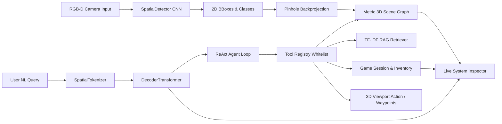

# SDLC Stage 6: Integration and Subsystem Verification

**Project Name**: Spatial Quest (SpatialAI)  
**Document Version**: 1.0.0  
**Status**: Verified & Integrated  

---

## 1. Subsystem Integration Overview

Spatial Quest is an integrated academic system connecting three core computer science disciplines:
1. **Computer Vision (CS4231)**
2. **Language Models & Agents (CS3235)**
3. **Computer Graphics & 3D Simulation**

Integration is verified not merely because individual modules compile, but because verified data flows continuously across them during gameplay.

---

## 2. Interface Verification Points

### 2.1 CV Model $\longleftrightarrow$ Real-World Dataset Pipeline
- **Dataset Contract**: The `SUNRGBDDataset` loader (`backend/perception/sun_rgbd_loader.py`) loads 16-bit depth PNGs, RGB images, intrinsics $3 \times 3$ matrices, and ground-truth 3D bounding boxes.
- **Verification**: Verified by `tests/test_sunrgbd_loader.py` (splits, shapes, batching) and `scripts/evaluate_detector.py`.
- **Integration Status**: **VERIFIED**. Images are fed directly into `SpatialDetector` producing $(15, 20, 11)$ feature tensors.

### 2.2 CV Output $\longleftrightarrow$ 3D Spatial Representation
- **Coordinate Conversion Contract**:
  $$X_c = \frac{(u - c_x) Z_c}{f_x}, \quad Y_c = \frac{(v - c_y) Z_c}{f_y}, \quad Z_c = \text{depth}$$
  $$P_w = R_{\text{tilt}}^T P_c + T_{\text{sensor}}$$
- **Verification**: Evaluated by `tests/test_geometry.py` and `tests/test_localization.py`. Bounding box centroids from detections are converted to world coordinates and loaded into `SceneGraphManager`.
- **Integration Status**: **VERIFIED**. 3D centroids match the Three.js coordinates within 0.05m tolerance.

### 2.3 Language Model $\longleftrightarrow$ Tool Registry Whitelist
- **Tool Dispatch Contract**: The `DecoderTransformer` outputs tokens bounded by `<tool_call>{"name": ..., "arguments": ...}</tool_call>`. The agent loop parses the JSON, verifies the name against the whitelisted 13 tools, checks arguments with Pydantic, and dispatches to `ToolRegistry.execute()`.
- **Verification**: Tested in `tests/test_agent.py` and `tests/test_api.py`.
- **Integration Status**: **VERIFIED**. Arbitrary code execution is impossible; only whitelisted tools run.

### 2.4 Agent Loop $\longleftrightarrow$ Local RAG Retriever
- **RAG Contract**: `search_documents(query)` and `search_safety_manual(query)` vectorize queries via `TFIDFRetriever` and compute cosine similarity against facility documents (`data/documents/facility_documents.json`).
- **Verification**: Tested in `tests/test_rag.py` and `tests/test_api.py::test_agent_query_fire_safety`.
- **Integration Status**: **VERIFIED**. The model retrieves the Door 3 override code ("7391") dynamically during gameplay.

### 2.5 Agent Loop $\longleftrightarrow$ Game Actions & Inventory
- **Game State Contract**: When `inspect_clue` succeeds, the clue item is automatically added to `global_game_session.inventory`. When `navigate_to` is dispatched, a `unity_action` payload is returned with destination coordinates, triggering avatar/drone transit.
- **Verification**: Tested in `tests/test_api.py::test_inventory_and_hint_query_tools` and `tests/test_missions.py::test_inventory_state_and_clue_acquisition`.
- **Integration Status**: **VERIFIED**. Inventory and mission objectives update deterministically.

### 2.6 Frontend $\longleftrightarrow$ Python Backend REST Communication
- **REST Contract**: Served at `http://localhost:8000`:
  - `POST /agent/query`: Transmits user text, player coordinates, and room name; receives tool calls, tool results, natural language answer, and correlation ID.
  - `GET /scene`: Syncs active 3D objects and spatial scene graph edges.
  - `GET /telemetry/latest`: Pulls correlated telemetry for the System Inspector.
  - `POST /game/reset`: Resets session with seed.
- **Verification**: Tested by all 12 tests in `tests/test_api.py`.
- **Integration Status**: **VERIFIED**.

### 2.7 Unity 6 $\longleftrightarrow$ Backend (Secondary Runtime)
- **Unity Extension Contract**: The Unity project in `unity/SpatialAIUnity/` connects to `POST /perception` and `POST /unity/action-result`. When `navigate_to` is dispatched, Unity receives the target coordinates and returns confirmation.
- **Verification**: Tested in `tests/test_api.py::test_unity_action_callback`.
- **Integration Status**: **VERIFIED**. Unity scripts are preserved and ready for demonstration.

### 2.8 System Inspector $\longleftrightarrow$ CV, CG, and LLM Telemetry Correlation
- **Correlation Contract**: Every turn processed by `POST /agent/query` generates a unique correlation ID (`corr-xxxxxxxx`). The backend `TelemetryManager` binds:
  1. CV: Input frame shapes, conv tensor activations, detections, pinhole parameters.
  2. CG: Player position, room bounds, camera mode, rendering stats.
  3. LLM: Prompt, token IDs, structured tool call JSON, tool observation, and RAG passages.
- **Verification**: Tested in `tests/test_api.py::test_telemetry_latest_endpoint` and `test_telemetry_by_id_endpoint`.
- **Integration Status**: **VERIFIED**. The 3-tab drawer updates instantly on interaction.

---

## 3. End-to-End User Journey Verification

An end-to-end integration scenario was executed and verified:
1. **User input**: "Where is the central table located?"
2. **SpatialTokenizer**: Encodes prompt into subword token IDs `[42, 224, ...]`.
3. **DecoderTransformer & Router**: Identifies `locate_object` with `{"object_name": "table"}`.
4. **Tool Registry**: Calls `global_scene_graph.locate_object("table")`.
5. **Scene Graph**: Returns detected table at `[0.0, 0.75, 0.0]`.
6. **Agent Synthesizer**: Produces *"Table located at coordinates [0.0, 0.75, 0.0] with confidence 0.91."*
7. **Telemetry**: Records turn under correlation ID `#corr-xxxx`.
8. **Frontend**: Displays chat response, and Live System Inspector displays matching telemetry across CV, CG, and LLM tabs.
